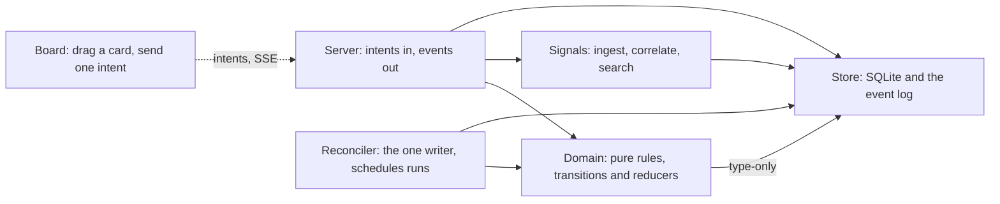

# Spec: keyframes, the first slice

**Size:** medium
**Scope:** keyframes

This spec covers one standalone tool. It is written so `/plumbbob:plan` can absorb it, or
spec-to-ridgeline can split it. The background is in [`inventory.md`](inventory.md) (what the
existing tools do, verified against code) and [`../README.md`](../README.md) (what keyframes is).

## Frame

- **Problem:** The intent behind a codebase lives in prose that nothing checks: specs,
  constraint files, decision logs, comments. As AI writes more of the code, the prose and the
  code drift apart silently. The inventory found this in five of these repos. For example,
  ridgeline's "hard gate" check command is never run, and runciter's "pure modules depend on
  nothing but types" rule is broken by one value import. People also have no small, legible place
  to state a system's shape and rules that agents read *and* a machine can hold them to.
- **Smallest thing that solves it:** A markdown plan format and a read-only checker. The plan is
  `keyframes.md`, or a `keyframes/` folder, holding intent, a map, constraints, scenarios,
  decisions and taste. `keyframes check` verifies three things:
  - every constraint and scenario is bound to an enforcer that exists;
  - the plan is well-formed and within its budgets;
  - once an extractor is configured, the code's dependency graph matches the map.
- **Done looks like:**
  - **Milestone 1:** `keyframes check` gates this repo through its own plan (dogfood). It also
    runs read-only against runciter, using a plan kept in this repo. It reports held, review,
    planned and dangling items with `file:line`, exits 0/1/2, and lands in `.check/keyframes.json`
    through a checkride custom check with no change to checkride.
  - **Milestone 2:** with the TypeScript extractor configured, runciter's concept roll-up matches
    the directory graph derived from fallow on 2026-10-02 edge for edge, and the check reports
    the `intents → stores` value import as a finding.
- **Explicitly NOT doing:**
  - `keyframes context` (scoped context for renderers);
  - `keyframes export fallow` (the explicit mirror);
  - dry-build sufficiency runs;
  - any canvas, editor or viewer beyond the Mermaid that GitHub already renders;
  - plumbbob, atis or ridgeline integration (each tool's own later build);
  - extractors for languages other than TypeScript, beyond one non-TypeScript test fixture;
  - running enforcers, or mutation evidence (`killedBy`);
  - checking runtime edges or trace assertions (`expect path` / `expect never`);
  - LLM judgment of any kind;
  - auto-fixing anything.

## Principles

These define what "intentionally not magical" means. Decisions below cite them as K1–K6.

- **K1. Humans commit; tools propose.** AI may draft an edit while a person approves it.
  Unattended tools never write the plan.
- **K2. Stands alone.** The plan reads as a plan with nothing installed, and renders wherever
  markdown renders.
- **K3. The checker writes nothing.** It reads the repo and reports.
- **K4. Plain files, explicit commands.** Other tools integrate through paths, a CLI, JSON
  and exit codes. No tool needs a code change to integrate.
- **K5. Sparse by budget.** Budgets are warned, never silently exceeded.
- **K6. Deterministic gate, advisory judgment.** Only bindings and structure fail. Anything
  judged is labeled `review` and never gates.

## Decisions

Format (what humans maintain):

- <a id="d1"></a>**D1 (plan-is-markdown)**: the plan is markdown, one line per item plus typed
  sub-lines, *because* the *because* clauses are prose people write, and the same file is
  generator context with no render step.
- <a id="d2"></a>**D2 (one-file-or-folder)**: a plan is `keyframes.md` with `##` sections, or
  `keyframes/` with one file per section, using the same grammar. A plan starts as one file.
  Both forms present is a usage error, *because* plans should be sized to the work and a section
  and a file must mean the same thing.
- <a id="d3"></a>**D3 (six-sections)**: the sections are Intent, Map, Constraints, Scenarios,
  Decisions and Taste. All are optional; other headings are free prose, *because* intent and map
  are the frames you draw, constraints and scenarios are the frames gauges hold, and decisions
  and taste are the style sheet for the tweens.
- <a id="d4"></a>**D4 (intent-is-prose)**: Intent has recommended headings (Problem, Who it's
  for, Done looks like, Not doing) and is never parsed, *because* intent is judgment and K6
  forbids pretending to check it.
- <a id="d5"></a>**D5 (item-ids)**: an item is `- **<C|S|D|T><n> (<slug>)**: <text>`. IDs are
  unique per section, a leading `<a id>` anchor is tolerated, and an in-plan citation must carry
  the slug verbatim, *because* a gloss travels with every reference and a wrong slug is caught
  mechanically (plumbbob [D74 (glossed-citations)](https://github.com/robmclarty/plumbbob/blob/main/docs/decisions.md#d74)).
- <a id="d6"></a>**D6 (held-by-required)**: every C and S item carries a `held-by:` sub-line
  holding enforcer pointers, `review`, or pointers marked `(new)`. A missing line is an error,
  *because* how a rule is held must be chosen, never absent by default.
- <a id="d7"></a>**D7 (review-warns)**: a C or S item held only by `review` warns and is counted.
  It never fails, *because* adoption shouldn't wait on enforcers, but the debt must stay
  visible.
- <a id="d8"></a>**D8 (new-marker)**: a pointer or bound path marked `(new)` is planned, and an
  unmarked target that doesn't exist is an error. A `(new)` target that now exists warns
  "drop the marker", *because* the plan must work before the code exists without hiding typos
  (night-shift's check-draft rule).
- <a id="d9"></a>**D9 (decisions-optional)**: D items may carry `held-by:`. Unbound decisions are
  counted, not warned. A D item without *because* warns, *because* most decisions are
  judgment, but a decision without its reason is a defect.
- <a id="d10"></a>**D10 (taste-never-held)**: a `held-by:` on a T item warns "promote to a
  constraint?", *because* of ridgeline's split: enforced taste is a constraint.
- <a id="d11"></a>**D11 (map-is-mermaid)**: the map is one or more fenced `mermaid` blocks in a
  restricted flowchart subset, with one block per view, followed by a visible bindings list
  (`- <concept>: <path>, <path>`), *because* it renders where people already read markdown (K2),
  and the bindings stay readable rather than hidden in comments.
- <a id="d12"></a>**D12 (map-canonical)**: the map is the source of the system's shape. Other
  tools' configs may mirror it, but never the reverse, *because* two hand-edited graphs drift
  (settled in design review, 2026-10-04).
- <a id="d13"></a>**D13 (two-edge-styles)**: a solid `-->` means "depends on", a prediction
  checked in milestone 2. A code edge missing from the map is an error (a divergence). A map edge
  missing from the code warns (an absence), or is planned when either end is a planned concept. A
  dotted `-.->` means "talks to at runtime" and is documented, not checked. Edge labels are free
  text unless reserved, *because* each line style carries one meaning, and reflexion models show
  absences are as informative as divergences ([Q6 (edge-meaning)](#q6)).
- <a id="d14"></a>**D14 (explicit-bindings)**: a concept binds to exact paths or `dir/` grants,
  never globs or inferred modules. A concept with no binding warns, *because* inference is magic
  and globs hide strays (plumbbob [D23 (no-glob-seams)](https://github.com/robmclarty/plumbbob/blob/main/docs/decisions.md#d23)).
- <a id="d15"></a>**D15 (budgets-warn)**: at most 7 concepts per map view, at most 20 taste items,
  and at most 3 sub-line keys per item. Breaches warn, *because* the plan stays sparse by budget
  (K5) without blocking.
- <a id="d27"></a>**D27 (type-only-label)**: the edge label `type-only`, exactly, is reserved and
  means "depends on types only". An extractor that reports no `kind` leaves such an edge
  "unchecked" (D24), *because* purity rules like runciter's need it, and it is the only reserved
  label ([Q3 (type-only-syntax)](#q3)).
- <a id="d28"></a>**D28 (unmapped-entry)**: the bindings-list entry `- (unmapped): <path>, …`
  names paths that deliberately belong to no concept. They are excluded from strays and counted
  in the report ("3 paths unmapped"), *because* plumbing belongs on no keyframe, and a strays
  report that's always noisy teaches people to ignore it ([Q5 (unmapped-paths)](#q5)).

Checker (machinery):

- <a id="d16"></a>**D16 (existence-not-passing)**: a resolver checks that an enforcer *exists*.
  Running it is the gate's job, *because* the checker stays read-only (K3) and the gate already
  runs the enforcers.
- <a id="d17"></a>**D17 (pointer-kinds)**: v0 kinds are `file:<path>`, `rule:<ast-grep id>`,
  `test:"<title>"` and `slot:<checkride check>`, plus the bare word `review`. Kinds are a data
  registry, and an unknown kind is an error naming the valid set, *because* adding a kind should
  be one row, and a typo must never read as held.
- <a id="d18"></a>**D18 (exit-taxonomy)**: exit 0 means no errors (warnings allowed), 1 means
  plan errors, and 2 means a usage or harness error (no plan, both forms present, bad config, a
  crashed extractor), *because* consumers already branch on checkride's 0/1/2.
- <a id="d19"></a>**D19 (stream-discipline)**: `--json` makes stdout exactly one JSON report;
  otherwise stdout carries the text report. Diagnostics go to stderr, *because* a checkride
  custom check stores stdout as the raw artifact `.check/keyframes.json`.
- <a id="d20"></a>**D20 (plan-and-root)**: `--plan <path>` and `--root <dir>` let a plan kept
  in one place check a repo somewhere else, *because* pilots must run against repos that stay
  read-only.
- <a id="d21"></a>**D21 (config-file)**: an optional `keyframes.config.json` sits at the root,
  beside `checkride.config.json`. v0 keys are `tests` (globs for `test:`) and, in milestone 2,
  `extract`. If it is absent, defaults apply and no extractor runs, *because* machinery stays out
  of the human plan.
- <a id="d22"></a>**D22 (init-writes-once)**: `keyframes init` writes a starter `keyframes.md`
  only if neither plan form exists, and refuses otherwise. It is the only command that writes,
  *because* scaffolding is an explicit human act and never an overwrite.
- <a id="d23"></a>**D23 (extractor-seam)**: the only language seam is an extractor command that
  prints `{schema_version, files[], edges[{from, to, kind?}]}`. The TypeScript scan ships as the
  first adapter through that same seam, *because* the format and core stay language-free.
- <a id="d24"></a>**D24 (degrade-visibly)**: with no extractor, solid edges report as
  "unchecked". A qualifier the extractor can't evaluate reports as "unchecked", never "held",
  *because* a missing instrument must read as missing (atis P8).
- <a id="d25"></a>**D25 (standalone-repo)**: keyframes is its own package and repo (this one), and this
  slice changes no existing tool, *because* of K2 and K4. Integration is configuration and
  prose, defined by the contract.
- <a id="d26"></a>**D26 (one-name)**: the folder, the tool and the command are all called
  `keyframes`, published as `@robmclarty/keyframes`, *because* one name has nothing to
  translate, and the unscoped npm name is likely taken.

## Constraints

- <a id="c1"></a>**C1 (functional-only)**: no `class`, `this` or `extends`; named exports only;
  tests in sibling `__tests__/`; enforced by ast-grep rules in `rules/`.
- <a id="c2"></a>**C2 (node-only-core)**: the core imports Node builtins only (Node ≥ 24). Only
  the TypeScript extractor may import `typescript`, resolved from the target repo.
- <a id="c3"></a>**C3 (read-only-check)**: `check` writes no file, makes no network call, and
  spawns nothing except the configured extractor.
- <a id="c4"></a>**C4 (no-prose-judgment)**: no LLM calls and no heuristics over prose. The parser
  reads IDs, sub-lines, map blocks and bindings only.
- <a id="c5"></a>**C5 (language-free-format)**: no format rule names a language, file extension or
  toolchain. Language lives only in extractors and pointer resolvers.
- <a id="c6"></a>**C6 (line-numbers)**: every error and warning names its `file:line` in the
  plan.
- <a id="c7"></a>**C7 (additive-schema)**: the report and edge JSON carry `schema_version`.
  Fields are added, never renamed or removed, under a given version.
- <a id="c8"></a>**C8 (checkride-gate)**: this repo gates on checkride (`pnpm check`), including
  its own `keyframes check` as a custom check.

## Steps

### Milestone 1: the format and the binding check

1. [ ] chore(repo): scaffold the package with a checkride gate, **done when:** `pnpm check` is
   green and `keyframes --help` prints the commands
   - seam: `package.json`, `bin/keyframes.js`, `src/cli.ts`, `checkride.config.json`, `rules/`
   - model: sonnet (mechanical scaffold)
2. [ ] feat(plan): find the plan and split it into sections, **done when:** fixtures for single
   file, folder, both (exit 2) and neither (exit 2) pass, with line offsets preserved
   - seam: `src/plan/`, `test/fixtures/plans/`
   - model: sonnet (fully specified)
3. [ ] feat(items): parse C/S/D/T items, IDs, slugs and sub-lines, **done when:** the grammar
   suite passes, covering malformed lines, duplicate IDs, tolerated anchors, unknown sub-line
   keys (warn) and wrong-slug citations, each reported with `file:line`
   - seam: `src/items/`
   - model: opus (the grammar is the product; edge cases matter)
4. [ ] feat(pointers): resolve file, rule, test and slot pointers, review and (new),
   **done when:** each kind has found, missing and planned fixtures, a `(new)` target that exists
   warns, and an unknown kind errors with the valid set
   - seam: `src/pointers/`, `test/fixtures/repos/`
   - model: sonnet (resolver per kind, data registry)
5. [ ] feat(report): compute statuses and budgets, render text and JSON, **done when:** golden
   tests pass for text and `--json`, the JSON validates against the published schema, and the
   exit codes follow D18
   - seam: `src/check/`, `src/report/`, `schema/keyframes.report.schema.json`
   - model: sonnet (fully specified)
6. [ ] feat(map): parse the Mermaid subset and the bindings list, **done when:** a
   runciter-shaped map parses; an out-of-subset line errors with `file:line`; budgets, unbound
   concepts, missing paths and `(new)` paths behave per D8, D14 and D15; and solid edges report
   "unchecked"
   - seam: `src/map/`
   - model: opus (subset boundaries are judgment)
7. [ ] feat(adopt): add init and write the contract and adoption snippets, **done when:**
   `keyframes init` writes the starter plan only when no plan exists (D22), a fixture repo wired
   with the checkride snippet produces `.check/keyframes.json`, and every snippet is copy-paste
   exact
   - seam: `docs/contract.md`, `docs/adopting.md`, `src/init/`
   - model: opus (prose a stranger must trust)
8. [ ] test(pilots): dogfood the tool and run the read-only pilots, **done when:** this repo's
   own `keyframes.md` gates through checkride; a fixture of plumbbob's C1–C7 in the grammar
   reports its checked-versus-review split; `pilots/runciter/keyframes.md` runs with
   `--root ~/projects/runciter/code/runciter` and changes nothing there; every finding is
   triaged in `docs/pilots.md` as plan wrong, code wrong or check wrong; and the
   [Q4 (test-matching)](#q4) spike records each `test:` pointer's match count and any false
   "held"
   - seam: `keyframes.md`, `test/fixtures/plumbbob/`, `pilots/`, `docs/pilots.md`
   - model: opus (triage is judgment)

### Milestone 2: the shape gauge

9. [ ] feat(extract): run the configured extractor and diff edges against the map,
   **done when:** a Go-shaped fixture, whose extractor only prints a committed JSON file,
   reports divergences as errors, absences as warnings (or as planned per D13), and strays
   excluding `(unmapped)` paths (D28); a crashing extractor exits 2; and dotted edges are
   skipped
   - seam: `src/extract/`, `schema/keyframes.edges.schema.json`, `test/fixtures/go-repo/`
   - model: opus (roll-up and diff semantics)
10. [ ] feat(extract-ts): add the TypeScript extractor as `keyframes-extract-ts`, **done when:**
   on runciter (read-only), the concept roll-up matches the fallow-derived directory graph edge
   for edge, and each edge carries `kind: value | type`
   - seam: `src/extractors/ts/`, `bin/keyframes-extract-ts.js`
   - model: opus (module resolution is subtle)
11. [ ] test(pilots): rerun the runciter pilot with extraction, **done when:** the
   `intents → stores` value import appears as a finding on the `type-only` edge (D27), and its
   triage is recorded in `docs/pilots.md`
   - seam: `pilots/runciter/`, `docs/pilots.md`
   - model: sonnet (run and record)

## Ownership

| Piece | Owner | Notes |
| --- | --- | --- |
| Format, checker, `init`, TypeScript extractor, schemas | **keyframes** (this repo, `@robmclarty/keyframes`) | Standalone (D25). |
| The contract (read · cite · defer · gate) | keyframes `docs/contract.md` | Written for someone who uses none of the other tools. |
| Gate wiring | each adopting repo's `checkride.config.json`, CI or pre-commit | Configuration only. checkride's custom check, no source change. |
| "Read" and "cite" | each adopting repo's `AGENTS.md` | keyframes publishes the stanza text and writes nothing. |
| "Defer", when a person is present | each adopting repo's `.claude/settings.json` (`ask` on `keyframes/**`, `keyframes.md`) | Same pattern as plumbbob's commit ask-hook. |
| "Defer", when no one is present | volley and night-shift `gate_paths`, per task | Existing configuration. |
| plumbbob opt-in | **plumbbob**, its own later build | A `keyframes` setting; intents cite standing IDs; the `constraints` row measured from `.check/keyframes.json` (D82's own "measured beats attested", no new row); `finish` *reminds*, never copies (D29). |
| `keyframes export fallow`, `keyframes context` | keyframes, a later slice | Not in this spec. |
| Dry-build sufficiency | **night-shift**, as a later kind | Regenerate one concept from its keyframes; tests decide. |
| An intent view in atis | not planned | Conflicts with atis §10 and P3 (see the inventory, §4). |

## Open questions

- <a id="q1"></a>**Q1 (package-name)**: *resolved:* 2026-10-04, `@robmclarty/keyframes`, with the bin `keyframes` (D26).
- <a id="q2"></a>**Q2 (repo-home)**: *resolved:* 2026-10-04, this repo, renamed `keyframes` (D25).
  It lives at `~/Projects/keyframes/code/keyframes`. The design record (inventory, design,
  references, ecosystem) stays in `docs/` beside the code.
- <a id="q3"></a>**Q3 (type-only-syntax)**: *resolved:* 2026-10-04, the reserved edge label `type-only` (D27).
  The question was how the map says "depends on types only".
- <a id="q4"></a>**Q4 (test-matching)**: is a literal substring of the test title, anywhere in
  the test globs, precise enough for `test:`? *resolve by:* spike, run inside step 8.
  - *plain:* substring search is language-free, but it can match a title quoted in a comment,
    another test's text or a skipped test, which would read as held when nothing holds it. The
    precise alternatives each break a principle. Parsing each language's test syntax breaks the
    language-free core (C5). Asking the test runner for its list means spawning tools (C3).
  - *lean (accepted for milestone 1, 2026-10-04):* substring matching, with more than one hit
    counted as a warning. Tighten it only if the pilots show a false "held". If one is needed,
    the tighter option is a test-lister seam shaped like the extractor seam (D23).
- <a id="q5"></a>**Q5 (unmapped-paths)**: *resolved:* 2026-10-04, a reserved `- (unmapped): …` bindings entry (D28).
  The question was how a plan says a path deliberately belongs to no concept.
- <a id="q6"></a>**Q6 (edge-meaning)**: *resolved:* 2026-10-04, "does depend on", the reflexion-model meaning (D13).
  The question was whether a solid edge is a permission ("may") or a prediction ("does").
  Divergences error; absences warn, or are planned when either end is planned.

## Appendix A: a plan in the format

This is the runciter pilot plan (`pilots/runciter/keyframes.md`). Every pointer below resolves
in runciter today, except the one marked `(new)`. It uses the `type-only` label (D27) and an
`(unmapped)` entry (D28).

````markdown
# runciter

## Intent

- **Problem:** agentic runs are hand-launched, unaudited and lost on restart.
- **Done looks like:** tasks queue, run under ridgeline, gate on the repo's own check, and land in
  a review column; state survives a crash.
- **Not doing:** multi-user, a second datastore, LLM-derived edges.

## Map



- board: `web/`
- server: `src/server/`
- domain: `src/intents/`, `src/events/`
- reconciler: `src/reconciler/`
- signals: `src/ingest/`, `src/correlate/`, `src/retrieval/`
- store: `src/stores/`, `src/db/`
- (unmapped): `src/bus/`, `src/config/`, `src/main.ts`

## Constraints

- **C1 (one-write-path)**: only the reconciler writes authoritative state, and every write appends an event.
  - held-by: rule:one-write-path, test:"replayed tasks/runs deep-equal the live projections"
- **C2 (sqlite-in-db)**: SQLite is touched only inside the db layer.
  - held-by: rule:sqlite-only-in-db
- **C3 (total-transitions)**: every (status, intent) pair is either a declared transition or rejected.
  - held-by: test:"transition table exhaustiveness"
- **C4 (kill-escalates)**: a run that ignores SIGTERM is SIGKILLed after a grace period.
  - held-by: test:"kill_run escalates to SIGKILL" (new)

## Scenarios

- **S1 (crash-recovery)**: a run left running by a killed daemon is failed as orphaned on restart.
  - held-by: test:"swept to failed(orphaned) on restart"
- **S2 (idempotent-intents)**: the same Idempotency-Key yields one intent and one task.
  - held-by: test:"same Idempotency-Key"

## Decisions

- **D1 (sqlite-only)**: one SQLite file holds state, log, vectors and text, *because* one boring database beats two.
- **D2 (no-auto-requeue)**: orphaned runs need a human retry, *because* a silent requeue hides the crash.

## Taste

- **T1 (named-exports)**: prefer named exports and kebab-case file names.
````

## Appendix B: the report

These numbers are illustrative.

```text
keyframes  pilots/runciter/keyframes.md  (root: ~/projects/runciter/code/runciter)
constraints   4 · 3 held · 1 planned
scenarios     2 · 2 held
decisions     2 · 2 unbound
taste         1 · ok
map           6 concepts · 7 edges · 1 runtime edge · solid edges unchecked (no extractor)
warnings      0
errors        0
```

## Appendix C: code shape

This sketch fixes conventions, not implementation. The style follows checkride and plumbbob:
type aliases, `readonly`, discriminated results, a data registry, named exports, `.js`
specifiers, and a doc comment on every function.

```ts
// src/pointers/registry.ts
import { existsSync } from 'node:fs'
import { join } from 'node:path'
import type { Repo } from '../repo/index.js'

/** A pointer as written after `held-by:`, e.g. `rule:one-write-path (new)`. */
export type Pointer = {
  readonly kind: string
  readonly target: string
  readonly planned: boolean
  readonly line: number
}

/** What a resolver found in the repo. Resolvers read; they never write (C3). */
export type Resolution =
  | { readonly status: 'found'; readonly where: string }
  | { readonly status: 'missing'; readonly reason: string }

/** One resolver per pointer kind. */
export type Resolver = (target: string, repo: Repo) => Resolution

/** The pointer kinds as data: adding a kind is adding a row (D17). */
export const RESOLVERS: Readonly<Record<string, Resolver>> = {
  file: resolveFile,
  rule: resolveRule,
  test: resolveTest,
  slot: resolveSlot,
}

/** The status a pointer earns: held, planned, stale-planned, or dangling (D8). */
export type PointerStatus = 'held' | 'planned' | 'stale-planned' | 'dangling'

/** Resolve one pointer, then apply the `(new)` marker rule. */
export function pointerStatus(pointer: Pointer, repo: Repo): PointerStatus {
  const resolver = RESOLVERS[pointer.kind]
  if (resolver === undefined) return 'dangling'
  const found = resolver(pointer.target, repo).status === 'found'
  if (pointer.planned) return found ? 'stale-planned' : 'planned'
  return found ? 'held' : 'dangling'
}

/** `file:<path>`: the path exists under the repo root. */
function resolveFile(target: string, repo: Repo): Resolution {
  return existsSync(join(repo.root, target))
    ? { status: 'found', where: target }
    : { status: 'missing', reason: `no file or directory at ${target}` }
}
```

The checkride wiring an adopting repo adds (configuration only, D25):

```json
{
  "checks": {
    "keyframes": {
      "command": "pnpm",
      "args": ["exec", "keyframes", "check", "--json"],
      "outputFile": "keyframes.json"
    }
  }
}
```
