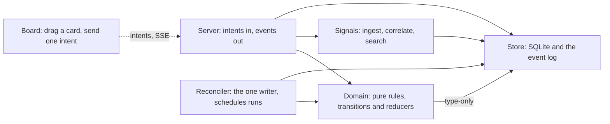

# Keyframe development, revised

> **Archived 2026-10-04.** Historical reference, not current intent. The current plan is
> [`docs/prototype.md`](../prototype.md); see [this folder's README](README.md) for why.

*People draw the keyframes, machines draw the in-betweens, and a check confirms the two still
agree.*

This is the revised design, dated 2026-10-04. It supersedes the draft of 2026-10-02
(`~/projects/_writing/_ai/ai_index_rocket_fuel/keyframe-development.md`). It is the argument
for the approach. Three other documents carry the rest:

| Document | What it holds |
| --- | --- |
| [`SPEC.md`](SPEC.md) | What gets built first. |
| [`inventory.md`](inventory.md) | What the existing tools actually do, verified against code. |
| [`references.md`](references.md) | The outside sources, verified. |
| [`ecosystem.md`](ecosystem.md) | Where keyframes sits among existing practice. |

**Change markers.** Every section opens with how it moved from the draft:

| Marker | Meaning |
| --- | --- |
| **[kept]** | survives as written |
| **[changed]** | survives in a different form |
| **[cut]** | removed, with the reason |
| **[deferred]** | right idea, wrong time |
| **[new]** | not in the draft |

## Changes at a glance

| Draft § | Outcome | In one line |
| --- | --- | --- |
| 1 Thesis | kept, sharpened | Same split. Condition 3 ("gauges actually detect violations") is now built first, and a fourth condition (sufficiency) is added. |
| 2 Existing tools | replaced | Most claims were partly wrong; see the inventory. The binding the draft wanted mostly exists already, scattered and unchecked. |
| 3 Artifacts | changed | `design/` + `layout/` + three `.check/` files become one plan (`keyframes.md` or `keyframes/`) and one report. |
| 4 Format | changed | Concepts + synchronization DSL becomes a Mermaid map (concepts, "depends on", "talks to") plus constraints *held by* named enforcers. |
| 5 Diagram vs DSL | changed | No canvas round-trip. The text is the diagram. *Verify across* survives as the shape gauge. |
| 6 Gauges | changed | Rules first (as binding existence), shape second; paths deferred; outcomes left to fascicle; taste never gated. Code carries no keyframe IDs. |
| 6 Triage | changed | Rerouted to what each loop can really absorb. |
| 7 Simulator | deferred, replaced | Design simulation deferred. A sufficiency gauge (dry build) takes its place in the plan. |
| 8 Loop | changed | Mapped onto the real tools, including night-shift and runciter. |
| 9 Composer tool | cut | No canvas, overlays or approval UI. GitHub renders the Mermaid. |
| 10 Talking to developers | kept | The keyframes diff is the PR's front page. |
| 11 Risks | extended | Eight risks the code revealed. |
| 12 First slice | replaced | See `SPEC.md`. |
| — | new | Principles K1–K6, the four-verb contract, planned state, and standalone positioning. |

---

## 1. Thesis [kept, sharpened]

An animator draws the keyframes and lets the machine draw the in-betweens. For software:

- **Keyframes (human-owned).** Intent, the shape of the system, the rules that must hold, and
  the journeys it must support. They are small and legible, debated with other people, and
  versioned in the repo.
- **Tweens (machine-owned).** The code. Regenerated freely, read on exception and in proportion
  to risk, edited directly when necessary, and reconciled afterwards.
- **Gauges (machine-run, human-trusted).** Mechanical comparisons of intended against rendered.
  They are the only reason it is safe not to read every line.

Two outside arguments frame where the human's work goes:

- [Kleppmann](references.md#kleppmann-2025): when AI writes the code, "the challenge will move to
  correctly defining the specification."
- [Litt](references.md#litt-2026): understanding *to verify* can be handed to machines;
  understanding *to participate* can't.

Keyframes are where people participate. Gauges are where the machine verifies.

"Correct" needs four conditions to hold together. The draft had three; **the fourth is new**:

1. The rendered system satisfies the keyframes, shown by evidence rather than self-report.
2. The keyframes are the right ones. This is human validation; no gauge does it
   ([Brooks](references.md#brooks-1987): essential complexity moves into the spec; it doesn't
   disappear).
3. The gauges actually detect violations. **Changed:** this is now the *first* thing built,
   because the inventory found the opposite in practice:
   - ridgeline's docs call its check command "a hard gate", and the harness never runs it;
   - runciter states a purity rule that one import already breaks.

   Prose claims of enforcement are the most common failure across these repos
   ([inventory §0](inventory.md#0-headline)).
4. **[new] The keyframes are sufficient.** An AI can regenerate a concept from them alone and
   pass its tests. This comes from your own Intent Engineering whitepaper ("spec coverage" by
   dry builds) and marrow's round-trip verification. It's the only evidence for the core claim
   that the tweens can be drawn from the keyframes.

**[new] Ownership is stricter than in the draft.** People commit keyframes. AI may draft an edit
while a person approves it, but nothing edits the plan unattended. That is the point of
keyframes: it is where the human work happens (principle K1 in the spec). The draft let tools
"fold" into the design automatically. That is cut.

## 2. What already exists [replaced]

The draft's table was written from READMEs. Checked against source, most rows were partly
wrong. The full verdicts are in [`inventory.md`](inventory.md). These are the ones that changed
the design:

- **The binding already exists in pieces, just scattered and unchecked.**
  - fallow's `boundaries` already declare concept-to-path zones and allowed edges (fascicle
    declares 13).
  - runciter's `TRANSITIONS` is a declared synchronization table.
  - plumbbob's `refs` slot already checks slugged ID citations mechanically.
  - night-shift's check-draft already grades a plan's citations against the repo, including a
    `(new)` marker.

  keyframes reuses these patterns rather than inventing a parallel layer.
- **Every existing "diagram held to code" test compares code with a picture of itself.**
  volley's README test and fascicle's blueprint rule 3 are documentation-drift tests. Nothing
  compared code against *independently authored* intent. That is the gap.
- **Only one loop has a deterministic check in its stop condition**, volley's, and even that
  can be switched off. ridgeline's reviewer is an LLM. night-shift measured that no candidate
  critic caught a planted false claim. LLM critics can't serve as gauges.
- **night-shift and runciter, which the draft never saw,** are the overnight runner and the
  control plane. Neither carries structured intent.

## 3. The artifacts [changed]

The draft had a `design/` tree with a `layout/` JSON folder, a build-intent delta, and three new
`.check/` files. **The revision:**

```text
keyframes.md          one plan, or keyframes/ with one file per section:
  ## Intent           prose; never parsed
  ## Map              Mermaid views (≤7 concepts each) + a bindings list
  ## Constraints      C-items, each held-by an enforcer, `review`, or `(new)`
  ## Scenarios        S-items, each held by a test
  ## Decisions        D-items, append-only, each with its *because*
  ## Taste            T-items, guidance only
keyframes.config.json optional machinery: test globs, the extractor command
.check/keyframes.json the report, stored by the gate (a checkride custom check), never written by keyframes
```

| Draft artifact | Outcome | Why |
| --- | --- | --- |
| **`design/` as a "fold target" for build intents** | **[changed]** to a standing plan that stands alone | Folding at `/plumbbob:finish` collides with plumbbob D29 ("nothing is copied out"). More importantly, it makes keyframes depend on plumbbob. Build tools may *cite* keyframe IDs. A person promotes what a build learned. |
| **Standing plan vs. build intent** | **[kept]** | Decisions stay append-only with *because*; the plan is current state. |
| **`layout/*.json`** (positions separate from meaning) | **[cut]** | It was there for a canvas. Mermaid lays itself out. With at most seven nodes per view, that is acceptable. |
| **`.check/provenance.json` and `.check/scenarios.json`** | **[cut]** | They sit outside checkride's contract ([inventory §4](inventory.md#4-conflicts-with-settled-decisions)). Provenance now lives in the plan itself (`held-by:`), and the report is one artifact. |
| **`baselines/scenarios.baseline.json`** | **[cut]** | Scenarios are held by tests. Fuzzy-outcome baselines remain fascicle's `bench`/`regression`, outside keyframes. |

**[new] One file first.** Following plumbbob's "size to the work", a plan starts as one file and
splits into a folder when it grows. A section and a file mean the same thing.

## 4. The keyframe format [changed]

**From concepts + synchronizations to concepts + edges + held-by.**

The draft proposed Meng & Jackson's concepts and synchronizations, with event rules such as
`when Http.post(/login) then RateLimit.take(ip)` ([Meng & Jackson](references.md#meng-jackson-2025)).
The revision keeps the *concept* and cuts the *synchronization DSL* for now:

- **Your real sketches aren't event graphs.** All 38 plumbbob builds across six repos fill
  their Architecture sketch. They hold deployment topologies, decision predicates, data
  pipelines and config-to-adapter chains, and none is a when/then rule graph
  ([inventory §1](inventory.md#plumbbob)).
- **The only edge that can be checked today is a static dependency.** Runtime causality needs
  traces, and those don't exist outside fascicle. fascicle's runner spans can't carry keyframe
  attributes, and its judges never see trajectories ([inventory §3](inventory.md#3-what-the-draft-reinvents-vs-what-it-assumes-into-existence)).
- **Where synchronizations really exist, they already live in code as data.** runciter's
  `TRANSITIONS` table is one. A later behavior view could point at such a table rather than
  restate it.

So the map has two edge styles, each with one meaning:

- a **solid** `-->` means "depends on", and is checked against the import graph (the meaning
  follows reflexion models: a prediction, not a permission; [SPEC D13](SPEC.md#d13));
- a **dotted** `-.->` means "talks to at runtime", and is documented, not yet checked.

**What survives from the draft's format:**

- **[kept]** Concepts map to deep modules through **explicit path bindings**, never inferred,
  never globs (plumbbob's D23 rule).
- **[kept]** Every item has a **stable, slugged ID**, and citations carry the slug verbatim, so a
  wrong slug is caught mechanically. This is the convention plumbbob's D74 enforces.
- **[kept, now mechanical]** **About seven concepts per view** is a budget the checker warns on.
  The draft justified it with the "Deutsch limit". [That attribution is
  weaker](references.md#deutsch-limit) than the draft implied, so the budget now stands on
  atis's attention budget and on the pilot evidence below, not on the aphorism.
- **[kept]** "A keyframe that encodes an implementation detail is a smell" is now checkable: at
  most three sub-line keys per item.
- **[changed]** Invariants (I-ids) merge into **Constraints**. *enforced-by* becomes `held-by:`,
  and the item must say what holds it: an enforcer, `review`, or `(new)`.
- **[changed]** Scenarios lose `expect path` / `expect never` and gain `held-by: test:"…"`. The
  trace assertions are deferred to the paths gauge (§6).

### One real flow, in seven concepts or fewer

runciter, verified against its import graph on 2026-10-02:



**What fitting it into seven taught us:**

1. **A concept is coarser than a directory.** Eleven `src/` directories group into five
   concepts, plus the web board.
2. **The grouping is where the design thinking happens.** Deciding that `ingest`, `correlate`
   and `retrieval` are one concept, Signals, is a keyframe-level judgment that the code never
   states.
3. **Plumbing doesn't belong on any keyframe.** That needs an explicit way to say "deliberately
   unmapped". The plan does that with an `(unmapped)` bindings entry ([SPEC D28](SPEC.md#d28)).
4. **It found a real thing on the first pass.** runciter's own docs say the pure modules "depend
   on nothing but types". `src/intents/types.ts:2` imports a *value* from the store. Whether
   that matters is exactly the keyframe/tween/gauge triage the process hands to a person.

## 5. Diagram vs DSL [changed]

The draft described three representations: intended, views and extracted. Its rule was "round-trip
within the intended model; verify intended ⟷ extracted".

**Revised rule: one text model that is its own view; verify intended ⟷ extracted.**

- **[cut] The canvas ↔ DSL round-trip.** Mermaid is both the DSL and the view, and GitHub and
  editors render it with no tool. You have specified an editable canvas twice before (foundry's
  mindustry, fascicle's sightline v2) and deferred it both times, while the read-only renderer
  shipped ([inventory §2](inventory.md#your-prior-art-the-draft-never-saw)). The draft's own
  CASE-tool warning ([Brooks](references.md#brooks-1987),
  [Dijkstra EWD667](references.md#dijkstra-ewd667), [MDA](references.md#omg-mda)) points the
  same way.
- **[kept] Verify across layers.** This is the shape gauge. It is the **reflexion model** from
  [Murphy, Notkin & Sullivan](references.md#murphy-1995): a hand-drawn high-level model, a
  mapping from source to model entities, and an extracted source model. Comparing them sorts
  every edge as a convergence, a divergence or an absence. keyframes' report is that
  classification: held edges, undeclared edges, and declared-but-missing edges. One detail to
  avoid: in the paper's figures a dotted line marks an absence, while keyframes uses dotted lines
  for runtime calls. Any annotated output keyframes renders must mark absences some other way.
  The nearest current work, [Spec Growth Engine](references.md#spec-growth-engine), gates on
  orphan code and undeclared dependencies, but lets AI agents rewrite its specs
  ([ecosystem §1](ecosystem.md#1-spec-driven-ai-development)).
- **[kept] Model vs views.** This is the C4/Structurizr idea
  ([Brown](references.md#c4-structurizr)): each Mermaid block is a view of one model, the
  concepts and their bindings.

**Extractors that exist today, and what's missing:**

| Extractor | What it gives | Status |
| --- | --- | --- |
| fascicle `describe` / `describe.json` | composition tree of a *constructed* flow | Works for fascicle flows only. Ids are counter-based, so they're unstable. |
| fallow `viz --viz-format dot\|mermaid`, `dead-code --trace-file` | file-level import graph; per-file JSON | Works for JS/TS, today. |
| atis's TypeScript compiler-API scan | module graph with workspace resolution | Lives inside an app, not exported. |
| volley / fascicle diagram-header tests | text tree of a flow, held to a header | Drift tests, not intended⟷extracted. |
| **missing:** a language-neutral seam | `{files, edges[{from, to, kind?}]}` from any command | **SPEC milestone 2**, with TypeScript as the first adapter. |

## 6. Gauges [changed]

| Gauge | Draft | Revision |
| --- | --- | --- |
| **Rules** | provenance map plus mutation testing of enforcers | **[changed, built first]** Every C- and S-item names what holds it. The checker verifies that the enforcer *exists*. Running it is the gate's job. Mutation evidence (did the enforcer kill mutants under the concept's paths? Stryker already records `killedBy`) is **[deferred]**. |
| **Shape** | extracted graph vs intended graph | **[kept, milestone 2]** The reflexion model above, through the extractor seam. An optional, *explicit* fallow mirror (`keyframes export fallow`, printed, never written) is **[deferred]**. |
| **Paths** | scenario traces vs `expect path` / `expect never` | **[deferred]** No runtime extractor exists outside fascicle, fascicle spans carry no keyframe attributes, and judges can't see trajectories. For now a scenario is held by a test that encodes its path. |
| **Outcomes** | fascicle bench + judges vs baseline | **[cut from keyframes]** fascicle already owns this. A scenario may point at a bench test. "Mutation-tested judges" turned out to mean Stryker on judge *code*, not judge calibration. |
| **Taste** | critic samples, noted not failed | **[changed]** Never gated, and **never fed to a convergence loop**. volley loops until its critic approves, so taste in the critic's prompt becomes retries. That is the failure ridgeline's constraints-vs-taste split exists to prevent. Taste is generator context only. |

**Where the binding is enforced [decided].** The draft wanted generated code to "sign its work"
with keyframe IDs in span attributes and module paths, enforced by an ast-grep rule. **Cut.**
The binding lives in the plan: path bindings and `held-by:` pointers, enforced by
`keyframes check`. The code stays unaware of keyframes, and that is what lets any renderer draw
tweens without customization (principle K4).

**The readout [changed].** The draft extended plumbbob's readout with a `keyframes` row. That
breaks D82's seven-row cap. Instead, keyframes has its own report. plumbbob may later
*measure* its existing `constraints` row from that report, which is D82's own "measured beats
attested".

**[new] Honest distribution over full enforcement.** Not everything can be deterministic, and
the design doesn't pretend otherwise. A constraint held only by `review` warns and is counted on
every run. The knob you tune most often is moving items between tiers: taste to constraint
(ridgeline's ratchet), and review to checked.

### Triage [changed]

The draft's three-way classification survives: the keyframe is wrong, the tween is wrong, or the
gauge is wrong. The routing is corrected to what each loop can really absorb:

| Loop | Absorbs tween bugs? | Evidence |
| --- | --- | --- |
| volley | **Yes**, when `--check` is set (a check in the stop condition). Taste must stay out of the critic. | `volley:src/loop_state.ts:61` |
| plumbbob | **Yes, at the boundary.** `checkpoint` refuses red, and the model iterates. Plan drift routes to `/plumbbob:refine` (D52). | `plumbbob:docs/decisions.md` D32, D52 |
| ridgeline | **No deterministic absorption.** Two retries on an LLM verdict, then exit 1. | `ridgeline:src/engine/builder.ts:61-65` |
| night-shift | **Inside volley only.** Afterwards, re-queueing is a human act. | `night-shift:docs/embedding.md:175` |
| runciter | **No.** Retry is a human intent. | `runciter:src/reconciler/orphans.ts:5-10` |

**Always routed to a person:** every red from `keyframes check`. A red means the plan, the code
or the check disagree, and only a person decides which one is wrong (K1).

## 7. The simulator [deferred, replaced]

- **[deferred] Level 1, design simulation** (walking scenarios over the graph; Alloy or TLA+ for
  critical flows). With a static dependency map there is little to simulate. It should come back
  if behavior views do. Lightweight formal methods remain the right ambition, and
  [Kleppmann](references.md#kleppmann-2025) and [AWS's TLA+ experience](references.md#newcombe-2015)
  make the case.
- **[deferred] Level 2, runtime simulation**, adversarial scenario generation, property-based
  parameters, and deterministic simulation with fault injection
  ([FoundationDB](references.md#foundationdb-sim), [TigerBeetle VOPR](references.md#tigerbeetle-vopr)).
  All of these wait for the paths gauge.
- **[deferred] Dead-keyframe mutation.** If no gauge goes red when a keyframe changes, the
  keyframe holds nothing. The rules gauge's `review`-only count is the cheap version today.
- **[new, replaces the simulator's role] The sufficiency gauge.** A night-shift kind regenerates
  one concept from its keyframes alone, in a sandbox, and runs that concept's tests. Failures
  mark what the keyframes left out. It runs overnight and is owned by night-shift.

## 8. The loop [changed]

frame → render → gauge → review → adjust → fold survives. *Simulate* is deferred (§7).

| Cadence | What happens | Tools, as they really are |
| --- | --- | --- |
| **Inner** (minutes) | Render one step; gauge; approve | plumbbob step and checkpoint. `keyframes check` runs inside the checkride gate: the fast Stop-hook profile per turn, the full gate at checkpoint (D75). |
| **Middle** (hours or overnight) | Converge tweens against the gauges | volley with `--check` (checkride auto-detect picks up the keyframes custom check). night-shift contained runs, triggered by hand today because its scheduler isn't built. runciter queues ridgeline runs and gates on `pnpm check`'s exit code, which includes keyframes. ridgeline has no deterministic gate. |
| **Outer** (days or weeks) | Edit keyframes; review the map with the team; promote learnings | A person edits `keyframes.md`. ridgeline's retrospective and `learnings.md` feed a *human* promotion. plumbbob's `finish` *reminds*, and the person moves items. |
| **Continuous** (every push) | Binding and shape gauges | The checkride custom check in CI, writing `.check/keyframes.json`. |
| **Overnight (later)** | Sufficiency | The dry-build night-shift kind (§7). |

- **[kept] Incremental rendering.** "Re-tween only the frames next to the moved key" becomes
  `keyframes context <concept>` **[deferred to the next slice]**: the scoped slice of the plan a
  renderer needs.
- **[kept] Direct code edits are hypotheses.** Drift shows up in the report as an undeclared
  edge or a missing path. A person promotes it (edits the map) or reverts it (fixes the code),
  never silently. This is plumbbob's D66 posture, applied to design.

## 9. The composer tool [cut]

Cut, in order of reasons:

1. **The canvas has failed this pattern twice.** Your editable canvases (mindustry, sightline v2)
   were specified and deferred while the read-only renderers shipped. Mermaid in GitHub *is* the
   read-only renderer, at zero cost.
2. **The overlays collide with atis's settled decisions.** atis §10 says "not an
   architecture-diagram product". Under P3, luminance already carries two meanings and the
   dashed ghost is taken.
3. **Per-keyframe approval inside a tool** collides with atis P7 and P9. Approval already exists
   as a git PR review of the keyframes diff.
4. **The teach-back latch** amends plumbbob D64. The comprehension goal it served is better met
   by making people *author* the keyframes (K1) than by making them type a line to unlock a
   checkpoint. In [Shen & Tamkin's trial](references.md#anthropic-2026), AI-assisted learners
   scored 50% against 67% for hand-coders, and the ones who kept their mastery used AI "to build
   comprehension", not just to produce code.

**[kept] Delivery.** A local CLI, no service, Mermaid in the PR.

## 10. Talking to other developers [kept]

Nobody holds a line-level theory of code they didn't write
([Naur](references.md#naur-1985)). So the PR's front page is the keyframes diff: the map
before and after (GitHub renders both), changed constraints, and new scenarios. The code diff is
a second tab, read by risk tier:

- auth, money, deletion, student data and anything irreversible get line-level eyes;
- the rest gets sampled.

Disagreements resolve as keyframe edits.

**[new]** keyframes stands alone (principle K2) so this conversation doesn't depend on anyone
adopting plumbbob, or liking it. The contract (read · cite · defer · gate) is written for a
reader who uses none of these tools.

## 11. Risks and guardrails [extended]

The draft's risks stand, and the revision answers them more concretely:

| Draft risk | Revised guardrail |
| --- | --- |
| **Rebuilding a CASE tool** | No generation, no canvas, and the plan is deliberately incomplete under budgets. |
| **Two sources of truth drifting** | The map is canonical. A mirror is printed for a person to commit, never written, and is checked for agreement. |
| **Gauges you can't trust** | Existence checks now, mutation evidence later. `review` is labeled and counted. |
| **Goodhart** | The gauges check bindings and structure, which a tween can't satisfy with prose. volley's `gate_paths` keeps unattended tweens away from the plan and the enforcers. |
| **Keyframes rot** | Every constraint must say what holds it. Planned items are counted, and stale `(new)` markers warn. |
| **Comprehension erodes** ([Bainbridge](references.md#bainbridge-1983)) | People author the plan (K1). |
| **Negative properties** | "Never" rules become constraints that need an enforcer, or show up as `review` debt. |

**[new] Risks the code revealed:**

1. **Existence isn't effectiveness.** `held-by: test:"…"` proves a test exists, not that it
   would catch a violation. The mitigation is mutation evidence (deferred), and meanwhile the
   report never says "enforced", only "held by".
2. **The checker could become the thing it checks:** a tool whose docs claim more than its code
   does, as with ridgeline's unrun "hard gate". The mitigation is dogfooding (the repo gates on
   its own plan) and K3/K6.
3. **A sixth graph.** Five graph models already exist across these repos
   ([inventory §0](inventory.md#0-headline)). The map must not become another unchecked copy. It
   is canonical, and mirrors are checked.
4. **LLM critics as gauges.** night-shift found that no candidate critic caught a planted false
   claim. LLM judgment stays `review`: counted, never gating.
5. **Substring test matching reads as falsely held** ([SPEC Q4](SPEC.md#q4)).
6. **Required `held-by:` adds adoption friction.** Mitigated by `review`, which warns rather
   than fails.
7. **Strays noise.** Plumbing reported as strays on every run teaches people to ignore the
   report. Mitigated by explicit `(unmapped)` entries ([SPEC D28](SPEC.md#d28)).
8. **Tool bias.** keyframes stands alone, so its reception doesn't hinge on plumbbob's.
9. **Brownfield adoption.** A map drawn from intent over an old codebase may show many
   divergences on the first run. ArchUnit's `FreezingArchRule` and checkride's baseline both
   grandfather existing violations and fail only new ones
   ([ecosystem §3](ecosystem.md#3-architecture-conformance)). keyframes will likely need the same.
   This is deferred until a pilot shows it.

## 12. The first slice [replaced]

See [`SPEC.md`](SPEC.md).

- **Milestone 1:** the format, the binding check, the contract, and read-only pilots (plumbbob's
  constraints and runciter).
- **Milestone 2:** the shape gauge, with the TypeScript extractor as its first adapter.

The draft's order was plumbbob's sketch first, then a checkride slot, provenance, scenarios,
atis and the fold. It is reversed. keyframes ships alone first, and every integration is
configuration.

## 13. References [moved]

See [`references.md`](references.md). Every outside source is verified there, with its status
and what it supports.
